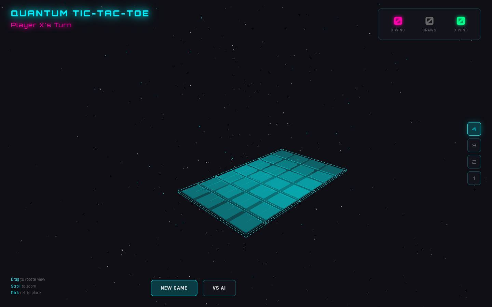
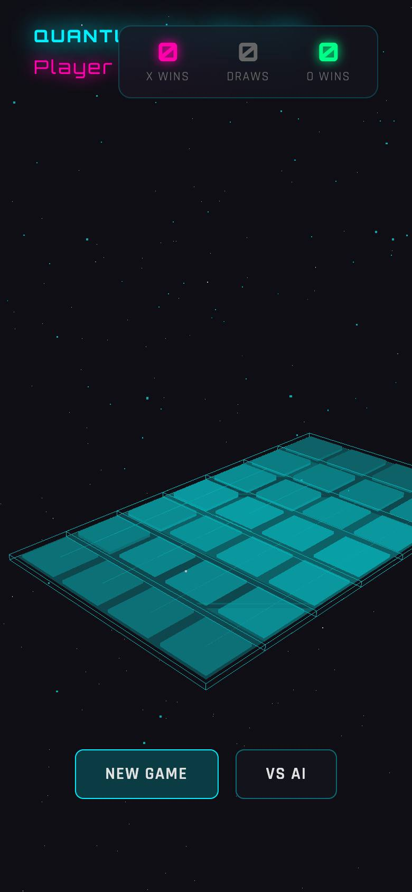

# Quantum Tic-Tac-Toe

> 3D tic-tac-toe on a 4×4×4 grid you can rotate and zoom, with an AI opponent at easy, medium and hard difficulty. A single HTML page — no build step.

**Live:** [tic-tac-toe-minimax-puce.vercel.app](https://tic-tac-toe-minimax-puce.vercel.app)

<p align="center">
  
  
</p>

## Built with

Three.js · JavaScript · HTML

## Run locally

```bash
python3 -m http.server 8000
# then open http://localhost:8000
```

## License

Released under the [MIT License](LICENSE).
